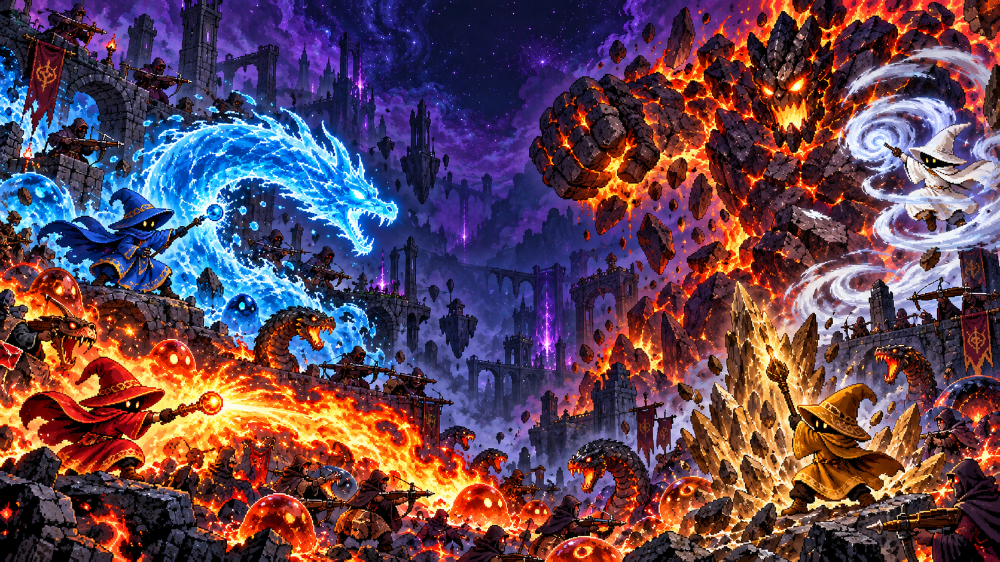

# ElMagica

**Build Beta1.0 (Endless Play/Mechanics Test)**

Created by: **SA_Ton_**  
Thanks to: **OpenAI Codex (GPT-6.1 Sol)**

Мой небольшой инди-проект на Java и LibGDX. Играешь за мага, поднимаешься по бесконечной башне, собираешь апы и пытаешься не отъехать на очередном боссе.

Сейчас это бета для проверки механик и баланса. Разрабатываю с помощью Codex, по ходу разбираюсь в коде и допиливаю игру.



## Как поиграть

Нужна **Java 17 или новее**, рекомендую Java 21. В архив она не входит.

1. Скачай `ElMagica-Beta1.0-play.zip` из Releases, когда сборка там опубликована.
2. Распакуй архив.
3. На Windows открой `play/Run-ElMagica.bat`.

Либо открой терминал в распакованной папке и запусти:

```sh
java -jar play/ElMagica-Beta1.0.jar
```

Игра запускается в полный экран и работает без интернета. В настройках есть русский и английский языки, размер ХУДа, панель статов и отдельная громкость музыки и эффектов.

## Что тут происходит

Выбираешь одну из четырёх стихий. У каждой своё заклинание: огонь взрывается, вода пробивает, земля отталкивает и замедляет, воздух рикошетит.

Круг стихий: **вода → огонь → воздух → земля → вода**. Стрелка показывает, кого стихия бьёт сильнее. В обратную сторону урон слабее.

На этажах мешаются слизни, стрелки и змеи. Враги выходят частями: убил одного — освободил место следующему. Чем выше, тем их больше и тем больнее они бьют.

Каждый седьмой этаж — босс с двумя стихиями. Победил — получаешь ап и полное лечение. Между боссами после первой победы встречается торговец: три товара, растущие цены и советы сомнительной полезности.

Зачистил этаж — открывается верхняя дверь, маг ускоряется, оставшийся лут сам летит к нему. Можно идти дальше, без беготни за последней монеткой.

Разбор атак, добычи и улучшений есть прямо в меню **«Механики»**. Сохранения забега пока нет.

## Управление

| Кнопка | Что делает |
| --- | --- |
| WASD | Движение |
| Курсор | Направление атаки |
| Зажатая ЛКМ | Стрельба; закликивание кд не обходит |
| 1–4 | Выбор стихии на экране выбора |
| E | Купить товар рядом или поговорить с торговцем |
| ESC | Пауза / назад |

## Собрать из кода

Нужен JDK, рекомендую Java 21. Gradle уже лежит в проекте в виде wrapper — отдельно ставить его не нужно. Для первой сборки понадобится интернет.

Windows, PowerShell из папки проекта:

```powershell
.\gradlew.bat build
.\gradlew.bat lwjgl3:run
```

Linux/macOS:

```sh
bash gradlew build
bash gradlew lwjgl3:run
```

Готовый JAR: `lwjgl3/build/libs/ElMagica-1.0.0.jar`. Внутри уже есть ассеты и библиотеки. Только JAR можно пересобрать командой `lwjgl3:jar`.

## Где что лежит

| Папка | Что внутри |
| --- | --- |
| `core/src/main/java/` | Игровая логика, отрисовка, меню и звук |
| `core/src/test/java/` | Проверки логики и столкновений |
| `lwjgl3/src/main/java/` | Запуск на компьютере |
| `lwjgl3/src/test/java/` | Проверки с настоящим окном LibGDX |
| `assets/` | Готовые картинки, музыка и звуки |
| `art-source/` | Исходные картинки и промпты генерации |
| `tools/` | Нарезка ассетов, генерация звука и подготовка архивов |
| `docs/` | Заметки, инструкции и сведения о зависимостях |
| `third-party-sources/` | Исходники сторонних LGPL-библиотек |

В коде обычные классы, условия и циклы. Комментарии — короткие рабочие заметки на русском. Если хочешь что-то поправить, загляни в [CONTRIBUTING.md](../CONTRIBUTING.md).

## Проверки

`build` запускает проверки игровой логики. Проверить запуск упакованного JAR:

```powershell
.\gradlew.bat lwjgl3:releaseSmokeCheck
```

Проверки интерфейса и звука работают в скрытых окнах:

```powershell
.\gradlew.bat lwjgl3:settingsLaunchCheck lwjgl3:languageLaunchCheck
.\gradlew.bat lwjgl3:waveDepthLaunchCheck lwjgl3:floorFinishLaunchCheck
.\gradlew.bat lwjgl3:merchantLaunchCheck
.\gradlew.bat lwjgl3:audioResourceLaunchCheck lwjgl3:audioSettingsLaunchCheck
```

Скриншоты сохраняются в `lwjgl3/build/`. Проверка аудиоресурсов использует настоящий звуковой движок, но с нулевой громкостью. Старое имя `waveDepthLaunchCheck` осталось; сейчас эта проверка про очередь врагов и очистку снарядов.

## Картинки, музыка и лицензии

Пиксельные картинки сделаны через генерацию изображений OpenAI. Исходники и промпты сохранены. Музыка и звуки синтезируются скриптом `tools/generate_audio.py`, скачанных треков и сэмплов в нём нет. Шрифт задан в коде.

Код проекта распространяется под [MIT](../LICENSE). У сторонних библиотек свои лицензии — они перечислены в [THIRD_PARTY_NOTICES.md](../THIRD_PARTY_NOTICES.md). Про ассеты подробнее в [docs/ASSETS.md](../docs/ASSETS.md).

## Что ещё стоит знать

Проверял игру на Windows. Поддержка запуска на Linux/macOS есть от LibGDX, но локально эти системы не проверялись. На поздних этажах может стать тесно: если безопасного места для спавна нет, следующий враг ждёт в очереди. Установщика и Java в комплекте нет.

Полезные заметки:

- [Что проверялось в коде](../docs/CODE_REVIEW.md)
- [Подготовка проекта к публикации](../docs/PUBLICATION_REVIEW.md)
- [Как загрузить исходники и сборку на GitHub](../docs/GITHUB_UPLOAD_RU.md)
- [Как сообщить о проблеме с безопасностью](../SECURITY.md)
